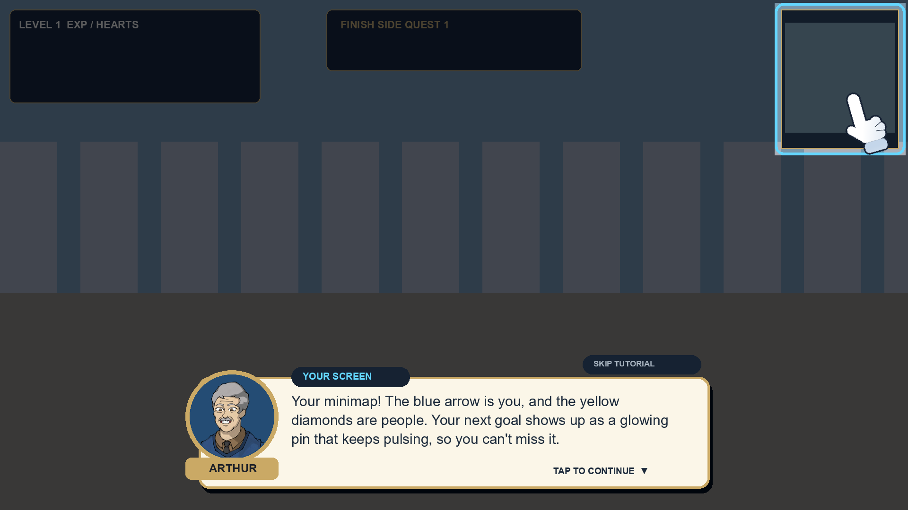
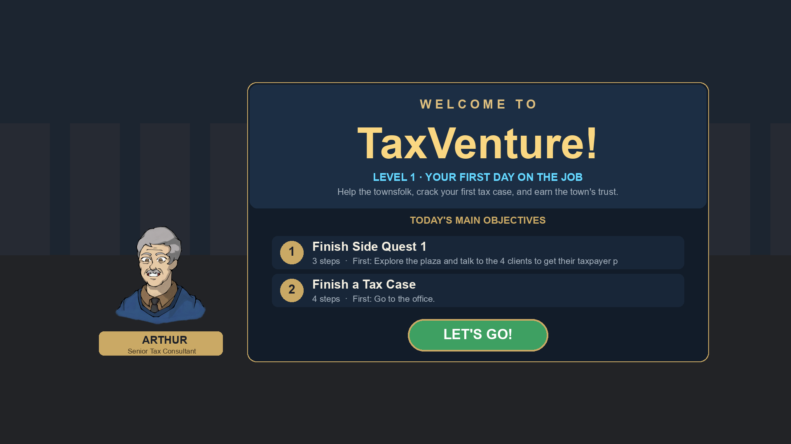

# Level 1 Guide & Tutorial

Office_Level1 is the introductory level, so it now has a full guided tutorial. **Arthur**, the senior tax consultant, talks the player through every part of the level in a casual voice. His portrait comes from `Assets/Resources/Tutorials/Portraits`. Glowing arrows on the ground, a floating goal marker and a pulsing minimap pin always lead the player to the current objective.

Everything the tutorial says and does is in one editable file:

**`Assets/Resources/Tutorials/Level_01/guide.json`**




*(These previews are layout mock-ups rendered from the same constants as the code. They are not Unity screenshots.)*

## 1. What the player sees

| When | What happens |
|---|---|
| Level starts | **Welcome card**: "WELCOME TO / TaxVenture!" with the letters popping in, the level subtitle and tagline, then the **main objectives** sliding in one by one. They are read live from `objectives.json`, so they always match. Arthur stands beside the card. **START** closes it. |
| Then | Arthur introduces himself and the day's two goals. |
| HUD tour | The spotlight dims the screen and glides from one HUD element to the next: objective tracker and clock, progress card (EXP and hearts), minimap, Profiles, Case Folder and Settings. The hand taps each one. |
| Notes (hands-on) | Arthur explains that Notes lists **all** of today's objectives and steps (the tracker shows only the next one). The player opens Notes, reads it, and closes it. |
| Walking | The hand pushes the joystick in a circle. The page ends after the player has walked 4 m. |
| Looking | The hand swipes the right side of the screen. The page ends after the player has turned 90°. |
| Follow the arrows | The ground arrows and the minimap pin are explained, then the player follows them for 8 m. |
| Near a plaza client | "Look at them and tap". The page ends when a conversation starts. During the first conversation a small hint says to tap the box. |
| Profile paper appears | The hand taps the paper. The page ends when the paper is collected. Then the player opens the Profiles cards and closes them again. |
| All 4 profiles | "Come find me", and the arrows lead to the guide. |
| Corkboard | The corners and the cards are explained. The hand drags a card onto a corner, and the page ends at the first placement. A wrong corner shows an encouraging hint. |
| Side quest done | The new EXP and hearts are pointed out, then the arrows lead to the office. |
| Reception, desk | Talk to the receptionist, then go to the desk and sit down. |
| At the desk | Drag the Case Folder off the pile. The three fields are explained. Drag the Tax Code Book out. **Value transfer**: tap a value, then tap a field (green means it fits, red means it doesn't), or drag the value onto the field. A value that fits a field is not necessarily the correct answer. A rejected value shows a hint. |
| All 3 fields filled | The hand drags the open folder onto the HUD folder icon. Then **Exit Desk**, then go to the Auditor. |
| At the Auditor | Arthur explains that talking only gets a reminder: you hand in by **dragging the Case Folder icon onto the Auditor**. The hand shows it, then you do it. |
| Tax Code Book | How to turn pages (right-edge arrow = next, left = back) and which section holds which field. |
| Investigate | Notes and Profiles work at the desk and anywhere. The player opens the client's profile next to the book (profile → book → folder) and closes it again. |
| Reward cards | Arthur explains the Side Quest Complete card, the Audit Summary and the Level Complete card. The card's auto-continue waits while he talks. The Level Complete talk ends the Level 1 tutorial and asks the player to tap Continue to go to the level select. |
| Audit failed | An encouraging retry talk. |

While a reward or summary card is up, the player can't walk or look around (`HudModalControlHold`). While dragging a value, a frame marks the field under the finger: green "DROP HERE" when it fits, red "WON'T FIT" when it doesn't (`DropAimIndicator`).

Players can skip the whole tutorial with **SKIP TUTORIAL** by tapping it twice. The objective arrows stay on after a skip.

Most important steps are **"your turn"** pages: Arthur explains, then the player has to do it before the tutorial moves on (walk, look, open and close Notes, open Profiles, follow the arrows, talk, pick up, drag on the corkboard, walk to the office, talk to the receptionist, sit at the desk, open the folder and book, select and place values by tapping and by dragging, store the folder, exit the desk, talk to the Auditor).

TaxVenture is a phone game, so all wording is for touch (`"platform": "touch"`).

### Page types
- **Tap to continue** (the page has no `waitFor`): the screen dims except for the spotlight hole and the player is held still. A tap first finishes the typing, and the next tap continues. Space and Enter also work on PC.
- **Your turn** (the page has a `waitFor`): nothing dims, the player plays, and the page ends when the action happens. Once read (3 s), or as soon as the player starts acting or opens a window, the box folds into the small top bubble so Notes, Profiles, the Case Folder and the world stay usable.
- The coach canvas (sorting order 5000) is above every HUD window, so the dialogue is never hidden behind Notes or the Case Folder.
- **Hint** (`"style": "hint"`): a small bubble at the top. It never blocks and goes away by itself after 5 s by default. Hints can show during conversations.

### Objective guidance (separate from the lessons)
The guidance stays hidden until Arthur introduces it: the first page with `"revealArrows": true` (`trail.waitForGuide`). It is shown at once if the tutorial is skipped.

- **Ground arrows**: flowing chevrons along a walkable route from the player to the goal.
- **Goal marker**: a floating pin with the goal's name and the distance in metres. When the goal is off screen, the marker sticks to the screen edge with an arrow.
- **Minimap**: a pulsing goal pin with a ripple and dots along the route. When the goal is off the map, the pin clamps to the map edge with an arrow. Each new objective **pops** the whole minimap with a glow. While the goal is still more than 12 m away, a reminder pop repeats every 8 s (`minimapReminderSeconds`).
- Everything hides during conversations, desk and corkboard views, and result cards.

## 2. Editing guide.json

Changes take effect on the next Play. Invalid lessons and pages are skipped, and a Console warning says why. The rest keeps working.

### Lessons
```json
{ "id": "corkboard", "title": "THE CORKBOARD", "when": "mode:CorkboardSideQuest",
  "onlyIn": "mode:CorkboardSideQuest", "after": "follow", "delay": 0.8, "duringDialogue": false,
  "pages": [ ... ] }
```
- Lessons are checked from top to bottom. Each one plays **once**, when its `when` is met and its `after` lesson has finished. Only one lesson plays at a time.
- `onlyIn` pauses the lesson (hides it) while the condition is false. For example, if the player leaves the desk, the lesson waits and comes back when they sit down again.
- `delay` is the number of seconds after `when` before the lesson shows.
- `duringResults: true` lets the lesson show over a reward card. `endIfGone: true` ends the lesson (instead of pausing it) when `onlyIn` stops being true.

### Pages
| Field | Meaning |
|---|---|
| `text` / `textTouch` / `textDesktop` | What Arthur says. The touch and desktop versions replace `text` on that platform. `{guide}` is replaced by the guide's name, and `{objective}` by the current objective step. |
| `mood` | Portrait: `default`, `wow`, `confused`, `sad` or `angry`. |
| `point` | What the spotlight and hand target (see Targets). |
| `gesture` | `tap`, `drag`, `swipe`, `joystick`, `hold` or `none`. |
| `to` | The end point of a drag. |
| `waitFor` | Leave empty for tap to continue, or name the action that ends the page. |
| `box` | `auto` (places the box on the other half of the screen from the spotlight), `top`, `bottom` or `center`. |
| `style` | `hint` for the small, non-blocking bubble. |
| `show` | `welcome` shows the welcome card. |
| `onlyOn` | `touch` or `desktop` limits the page to one platform. |
| `title` | The chip above the text. It defaults to the lesson's `title`. |

### Triggers (`when`, `onlyIn`, `waitFor`). Join with `|` for "any of".
- **Events** (add `#n` to require n times, e.g. `value:placed#3`): `start`, `lesson:<id>`, `event:<objective event>` (see `ObjectiveTriggers`), `state:<GameState>`, `dialogue:start`, `dialogue:end`, `value:selected`, `value:placed`, `value:rejected`, `corkboard:placed`, `corkboard:wrong`. In `when`, an event counts if it ever happened. In `waitFor`, it only counts if it happened after the page appeared.
- **Conditions**: `card:<audit|sidequest|level|result|any>` (that reward card is open; give the lesson `duringResults` and `endIfGone`), `open:<notes|profiles|folder>` (that HUD window is open), `active:<target>` (the object is switched on, e.g. the open case folder after dragging it out), `not:<condition>` (e.g. `not:open:notes` = Notes closed), `mode:<FirstPerson|Workstation|CorkboardSideQuest|ProfileViewer|Interview>`, `step:<objectives.json trigger>` (that step is the current one), `near:<metres>:<target>`, `visible:<target>`, `profiles:<n>`, `case:filled`, `dialogue:active`.
- **waitFor only**: `tap`, `move:<metres>`, `look:<degrees>`, `seconds:<n>`.

### Targets
`hud:objective` · `hud:progress` · `hud:timer` · `hud:minimap` · `hud:notes` · `hud:folder` · `hud:profiles` · `hud:settings` · `hud:icons` · `hud:joystick` · `hud:look` · `hud:prompt` · `hud:exit` · `world:<scene path>` · `type:<ComponentName>` (picks the best active one: on screen and still useful, e.g. an unsolved corkboard corner) · `ui:<UI object name>` · `screen:x,y[,w,h]` (fractions of the screen) · `waypoint` (the current objective goal) · `chip` (a Tax Code value that an empty case-folder field accepts) · `field` (the field that takes the value in hand; never Name or TIN).

If a target is not on screen, the box still shows, but without the spotlight and hand.

### Objective arrows (`waypoints`)
```json
{ "step": "event:ReceptionistTalkedTo", "target": "Environment/OfficeBuilding/Rooms/Reception/Receptionist",
  "label": "Receptionist", "pick": "nearestAvailable", "arriveDistance": 2.2 }
```
- `step` must match the step's `trigger` in `objectives.json` exactly.
- `target` takes one or more scene paths or `type:` names joined with `|`.
- `pick: nearestAvailable` chooses the closest target that still has something to do. For example, it skips NPCs whose marker is "done" and includes profile papers waiting on the ground. The other options are `nearest` and `first`.
- If you add a new objective step, add a waypoint for it. A step whose trigger is `area:` and has no waypoint uses the centre of the area.
- `trail` settings: colour, spacing, length, speed, beacon on/off, minimap on/off, arrive distance and reminder pop interval.

### Replacing the portrait
Put your images in `Assets/Resources/Tutorials/Portraits/` with Texture Type **Sprite (2D and UI)**, and list them in `guide.portraits` by mood. You can also overwrite the `Arthur-*.png` files and keep their names. To rename the guide, change `guide.name` and `guide.role`.

### Other settings
`enabled` turns the whole guide on or off. `platform` is `touch` (default, the game is mobile), `desktop`, or `auto` (touch on phones and in the Editor). `rememberFinishedLessons: true` skips finished lessons on the next run on the same device (PlayerPrefs). `startDelay` and `lettersPerSecond` control timing.

## 3. Code map (`Assets/Scripts/UI/Guide/`)

| File | Role |
|---|---|
| `GuideRuntime` | Self-bootstraps in Office_Level1 and builds its own overlay canvas (sorting order 400) with the beacon layer, coach view, director and objective guide. It makes no scene edits. |
| `GuideScript` | The JSON data classes, loading and validation. |
| `GuideTriggers` | The trigger vocabulary: parsing and validation only (pure code). |
| `GuideTargets` | Turns a target key into a screen rectangle and world position. Read-only. |
| `GuideDirector` | The lesson state machine. It counts game events, checks conditions, plays pages and holds the player still on tap pages. |
| `GuideCoachView` | The dim layer and spotlight frame, the speech box (portrait medallion, name plate, chip, typewriter, footer, two-tap skip) and the hint bubble. |
| `GuideHand` | The animated glove: it glides between targets and acts out tap, hold, drag, swipe and joystick gestures with ripples. |
| `GuideWelcomeCard` | The opening card. |
| `GuideArt` | Procedural sprites (glove, ring, frame, glow, pin, arrow, dot, chevron) and the ground-arrow mesh shape. |
| `GuideTapCatcher` | Forwards taps on a transparent graphic. |
| `ObjectiveGuide` | Chooses the goal for the current step, finds the route, and drives the trail and beacon. It also publishes the goal for the minimap. |
| `GuideGridPath` | Lazy grid built from physics probes, with A* (see the decision below). |
| `ObjectiveTrail` | Flowing chevrons drawn as one dynamic mesh (Sprites/Default, always included in builds). |
| `ObjectiveBeacon` | The floating goal marker. |
| `../OfficeMinimapObjective` | The minimap goal pin, route dots and attention pops. `OfficeMinimap` creates and ticks it. |

**Decision: no NavMesh.** The scene has no baked NavMesh, and its floors and walls are MeshColliders with non-readable meshes. A runtime NavMesh build can use them in the editor but not in an Android player. Physics queries do work on them, so `GuideGridPath` probes 0.5 m cells only when the search reaches them, caches the results and runs A* over them. Probes per search are capped. When the goal can't be reached, the route goes to the closest point, followed by a short straight hint toward the goal.

**Integration points.** All of these only observe the game:
- `TownEvents` and `GameplayEvents`
- `GameStateMachine.OnStateChanged`
- `ValueTransferManager` events
- `CameraController.CurrentMode`
- `DialogueUI.IsAnyDialogueActive`
- `OfficeObjectives.Snapshot`
- polling of `CorkboardSlot` and `CorkboardSideQuestManager.WrongPlacements`

The only change to existing gameplay or UI code is that `OfficeMinimap.cs` now creates and ticks `OfficeMinimapObjective`.

The legacy `TutorialController` / `TutorialPanel` (Resources/Tutorials/level1_tutorial.json, which is empty) is untouched and still does nothing.
