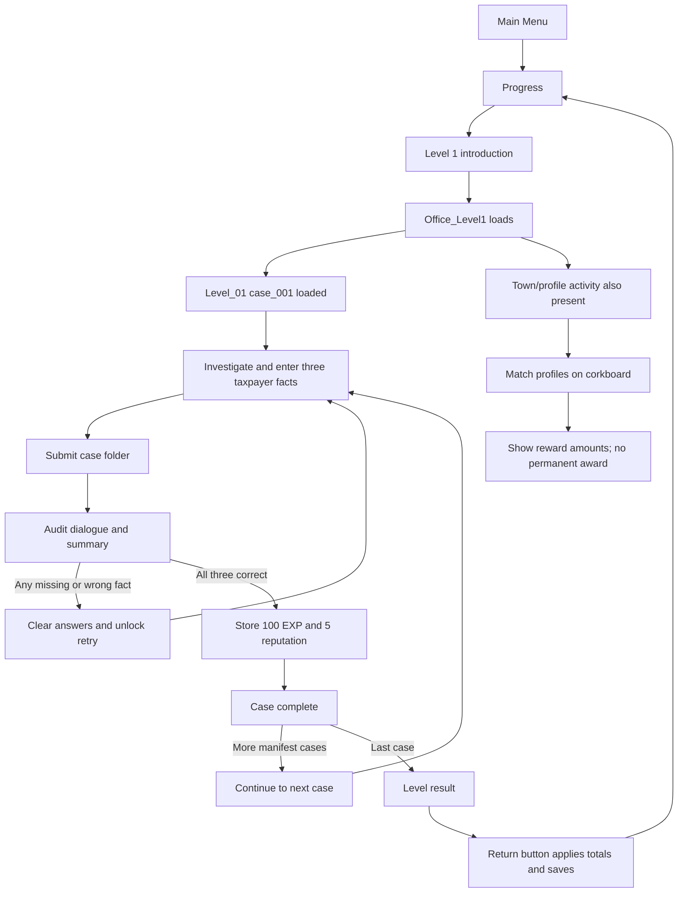

# TaxVenture: current game flow

Review date: 12 October 2026. Companion document: [logic audit](C:/Learn/Projects/TaxVenture/TaxVenture/docs/LOGIC_AUDIT.md).

This describes the current implementation, not an approved design specification. No gameplay code, scenes, prefabs, JSON content, or settings were changed for this review. The investigation follows first-party scripts, content, scene serialization, and relevant prefab wiring. It does not certify a successful Unity build or Android playthrough. Initialization and wiring defects listed in the audit can interrupt the flows below.

## 1. The most important distinction

There are two overlapping versions of the game in the project:

1. **The current Level 1 classification exercise:** learn about the client, fill three taxpayer facts, submit the folder, retry until correct, receive rewards, finish the level.
2. **The larger office simulation:** review documents, interview, research, compute, assess, stamp, prepare/print a return, audit, present findings, archive, and receive results.

Many components for the second version remain, but they do not form the currently enforced completion route. Having a state class or a UI panel does not mean the normal player flow reaches it.

The current camera controller also uses **first-person exploration**, with fixed workstation and conversation views. The README's third-person description is outdated.

## 2. Launch, menu, and level selection

The first enabled scene in the checked-in build settings is `MainMenu`. The enabled scenes are MainMenu, Office_Level1, Progress, Level1_Character_Intro_Cutscene, and Settings.

1. MainMenu initializes persistent audio and player progression managers.
2. Player progression loads `Save/progress.json` under Unity's `Application.persistentDataPath`. Missing or unreadable data produces a fresh in-memory progress record.
3. Start Game opens Progress. It does not resume a partly completed case.
4. Progress displays total EXP, total reputation, and `levelsCompleted`.
5. Level 1 is always selectable. Level 2 becomes interactable when `levelsCompleted >= 1`.
6. Level 1 opens its introduction cutscene. Continue advances images with fades; finishing loads Office_Level1, as configured in the scene.
7. Level 2 is unfinished: its actual button has no click callback, its configured cutscene is missing, and Office_Level2 is not enabled in build settings.

Sources: [build settings](C:/Learn/Projects/TaxVenture/TaxVenture/ProjectSettings/EditorBuildSettings.asset), [MainMenuUI](C:/Learn/Projects/TaxVenture/TaxVenture/Assets/Scripts/UI/MainMenuUI.cs), [ProgressUI](C:/Learn/Projects/TaxVenture/TaxVenture/Assets/Scripts/UI/ProgressUI.cs), [cutscene controller](C:/Learn/Projects/TaxVenture/TaxVenture/Assets/Cutscenes/Script/Level1CutsceneController.cs).

## 3. What starts when Office_Level1 loads

The same scene contains office systems and the town/profile side quest.

- CaseProgressionManager automatically calls `StartLevel("Level_01")`.
- The level manifest lists only `case_001`. The second case file exists but is not selected by this level.
- JsonCaseLoader reads the level and case from Resources. CaseFactory creates a fresh CaseData instance.
- Name, TIN, authored case information, and supporting-document names are initialized. The three taxpayer answers begin empty. Numerical computations begin at zero; the initial assessment is NotReadyForFiling.
- The client display is selected by `clientId`.
- Submission state is reset and the manager requests ReceiveCaseState.
- Separately, GameStateMachine.Start requests IdleGameState. There are two active FSM components in this scene, so this startup is not reliably coordinated; see the audit.
- TutorialController is configured to auto-start, but its JSON file is empty. The configured tutorial popup sequence cannot begin.

There is no implemented requirement in CaseProgressionManager to finish the town side quest before loading the office case.

Sources: [case progression](C:/Learn/Projects/TaxVenture/TaxVenture/Assets/Scripts/Data/CaseProgressionManager.cs:73), [case factory](C:/Learn/Projects/TaxVenture/TaxVenture/Assets/Scripts/Data/CaseFactory.cs), [Level 1 manifest](C:/Learn/Projects/TaxVenture/TaxVenture/Assets/Resources/Levels/Level_01/level.json), [tutorial controller](C:/Learn/Projects/TaxVenture/TaxVenture/Assets/Scripts/UI/Tutorial/TutorialController.cs).

## 4. Town/profile side quest

The side quest is a separate collection-and-matching activity within Office_Level1, not a separate enabled TownEnvironment scene.

The scripts implement NPC conversations, collectible taxpayer profiles, a profile collection HUD, an Arthur/tutorial-NPC interaction, and a corkboard matching activity. The board checks whether every configured classification slot is solved. Incorrect matches can be retried; the manager has no countdown or failure score. Once solved, it hides the activity after a short delay and raises the side-quest-completed event.

The configured/default reward presentation is **50 EXP and 10 reputation**, but `GrantRewards()` only logs that award. It does not add it to PlayerProgressManager or write it to disk. The completion popup displays a result; showing a result is not the same as saving a reward.

TownToOfficeTransition listens for completion and can activate an optional indicator. It does not load the office, start a case, or enforce a door/progression gate. Its comments describe possible future implementations.

Sources: [side-quest manager](C:/Learn/Projects/TaxVenture/TaxVenture/Assets/Scripts/SideQuest1/CorkboardSideQuestManager.cs), [side-quest result UI](C:/Learn/Projects/TaxVenture/TaxVenture/Assets/Scripts/SideQuest1/SideQuestCompleteUI.cs), [town-to-office transition](C:/Learn/Projects/TaxVenture/TaxVenture/Assets/Scripts/SideQuest1/TownToOfficeTransition.cs).

## 5. Receiving and investigating the office case

### Receptionist

The receptionist reads the current case's JSON greeting. Finishing it marks that case ID as already spoken to, requests ReceiveCaseState, unlocks the notes HUD event, and reports the tutorial interaction. The case itself was already loaded at scene startup; this conversation does not create it.

### Exploration and desk

Normal exploration uses first-person camera controls, Rigidbody movement, a mobile joystick, and a center-screen interactable ray. Entering the desk/workstation disables normal movement and switches to the assigned viewpoint. Workstation interactions use their own raycasting and exit controls. Folder/book objects also have pointer and drag interfaces.

### Case folder

The current CaseFolderUI builds **one page**, called Taxpayer Information. It contains name, TIN, and three editable categories:

| On-screen field | Stored value | Current Marie case answer |
|---|---|---|
| Taxpayer Classification | residencyStatus | ResidentCitizen |
| Taxpayer Type | taxpayerType | CompensationEarner |
| Income Sources | incomeSource | EmploymentIncome |

Opening the folder can move the game to ReviewDocumentsState. The older page-building functions for other parts of the case still exist, but BuildPages does not include those pages. SupportingDocumentsPageLink expects page index 5, which the one-page folder cannot reach.

### Client interview

The current ClientInteractable uses sequential JSON dialogue, not the old question-selection interview UI. Finishing the conversation marks that NPC as interviewed and reports the tutorial event. **It does not populate the three answers in CaseData.** The player still needs to enter/transfer the classifications.

The NPC's `hasInterviewed` flag prevents a second interview. The audit retry does not reset that flag. The older InterviewClientUI/InterviewDataProvider code writes hardcoded answers, but that is not the normal ClientInteractable route.

### Tax book and transferring answers

The tax book reads authored ScriptableObject sections and presents selectable value chips. The transfer system holds a selected DataValue, checks whether the destination accepts its type/semantic key, and asks the destination to write it. Successful transfer clears the selection; rejected placement retains it.

Transfer acceptance and audit correctness are different things: a value can belong to the right category but be the wrong answer for this client. ComplianceChecker grades the three answers later.

Sources: [receptionist](C:/Learn/Projects/TaxVenture/TaxVenture/Assets/Scripts/Interactables/ReceptionistInteractable.cs), [camera](C:/Learn/Projects/TaxVenture/TaxVenture/Assets/Scripts/Player/CameraController.cs), [folder](C:/Learn/Projects/TaxVenture/TaxVenture/Assets/Scripts/UI/CaseFolderUI.cs:350), [client](C:/Learn/Projects/TaxVenture/TaxVenture/Assets/Scripts/Interactables/ClientInteractable.cs:32), [value transfer](C:/Learn/Projects/TaxVenture/TaxVenture/Assets/Scripts/Data/DragDrop/ValueTransferManager.cs).

## 6. Submitting, passing, and retrying

The actual audit submission is driven by the folder submission value, `Submit_CaseFolder`. Talking to the auditor gives a reminder; accepting the folder starts the final audit.

1. The tray accepts the folder key and prevents that same key being submitted again until reset.
2. It invokes BeginFinalAudit twice consecutively: a confirmed duplicate call, not two separate intended audits.
3. AuditSubmittedState locks ordinary backward state transitions.
4. ComplianceChecker compares residencyStatus, taxpayerType, and incomeSource with the current JSON answer key.
5. A missing or incorrect value counts as an issue. An unparseable answer-key enum also fails the check.
6. The auditor displays dialogue and then an issue-summary popup.
7. After the summary closes, zero issues means success. Otherwise the case resets for retry.

**What is not required by this audit:** correct tax calculations, a stamp, the actual Ready/NotReady assessment, a selected/encoded form, a printed return, reviewed documents, a completed interview, client presentation, or archiving. Some UI paths may encourage these actions, but the audit's grading code does not enforce them.

### Failure

The retry clears the three facts, other classification choices, stamp assessment, encoded form, and audit bookkeeping. It restores folder submission availability, unlocks progression, and requests ReceiveCaseState.

It does not record a lasting failed-attempt count or apply an EXP/reputation penalty. It also does not fully reset every case-related field, interview flag, task marker, or timer. See the audit for the exact consequences.

### Success

The auditor calculates and stores a case reward, then goes directly to CaseCompleteState. That raises the case-completed HUD event and asks CaseProgressionManager what comes next.

- If another manifest case remains, a Continue popup advances to it.
- If this was the last case, LevelCompleteState shows the aggregate result.
- In the current Level_01 manifest, there is only one case, so success immediately finishes the level.

This diagram describes the intended execution of the current code paths; it does not imply all scene/input defects have been resolved.

Sources: [submission tray](C:/Learn/Projects/TaxVenture/TaxVenture/Assets/Scripts/Data/AuditorSubmissionTray.cs), [auditor](C:/Learn/Projects/TaxVenture/TaxVenture/Assets/Scripts/Interactables/AuditorInteractable.cs:76), [compliance checker](C:/Learn/Projects/TaxVenture/TaxVenture/Assets/Scripts/Data/ComplianceChecker.cs), [retry reset](C:/Learn/Projects/TaxVenture/TaxVenture/Assets/Scripts/Data/CaseData.cs:130).

## 7. Rewards: defined rules versus reachable rules

RewardsCalculator defines four tiers:

| Recorded outcome | EXP | Reputation |
|---|---:|---:|
| Correct verdict, no issues | 100 | 5 |
| Correct verdict, issues | max(0, 100 − 15 × issues) | max(0, 5 − issues) |
| Wrong verdict, no issues | 20 | 0 |
| Wrong verdict, issues | 0 | 0 |

However, the current auditor sets verdict correctness from `issues.Count == 0`, rather than comparing the player's stamp with a correct assessment. That couples the verdict and issue result together. It then retries failures and only rewards successful cases. Therefore **the normal completed-case path currently reaches the 100 EXP / 5 reputation tier**; the other reward tiers are not normal completed outcomes.

Concrete examples:

- Correct three facts on the first attempt: 100 EXP, 5 reputation.
- Several failed attempts, then correct three facts: still 100 EXP, 5 reputation.
- Correct three facts but no stamp or an incorrect stamp: the audit still treats the submission as successful.
- Wrong/missing fact: retry; no permanently recorded failed-case result.
- Finish the profile side quest: reward amounts appear, but permanent totals do not increase through its reward method.

LevelRewardAccumulator adds case results and sums EXP/reputation. Time does not affect either award. There is no reputation loss below zero, spending system, or grade based on speed in this reward implementation.

Sources: [reward calculator](C:/Learn/Projects/TaxVenture/TaxVenture/Assets/Scripts/Data/RewardsCalculator.cs), [outcome classifier](C:/Learn/Projects/TaxVenture/TaxVenture/Assets/Scripts/Data/ClientOutcomeBranch.cs), [accumulator](C:/Learn/Projects/TaxVenture/TaxVenture/Assets/Scripts/RewardsSystem/LevelRewardAccumulator.cs).

## 8. Saving, replaying, and timers

The Level Complete return button applies the accumulated result to permanent progress, increments `levelsCompleted`, writes the JSON file, and opens Progress. Reaching the result screen alone does not save the reward. Exiting before pressing that button loses that session's uncommitted award.

The save contains only:

- totalExp;
- totalReputation;
- levelsCompleted.

It does not contain individual completed level IDs, case answers, attempt history, NPC interview state, side-quest completion, player position, or an in-progress case. Replaying Level 1 and completing it again adds rewards and increments the completion count again. That count represents completed runs, not distinct levels.

There are three time measurements:

| Timer | Behavior |
|---|---|
| HudTimer | Counts scene time continuously using deltaTime |
| LevelTimer | Latches first observed ReceiveCase and first AuditSubmitted; not reset for another attempt/case |
| CaseProgressionManager caseStartTime | Starts on case load; used by the alternate per-case results path |

The level result uses LevelTimer, so it can disagree with the HUD and omit later retries/cases. Settings do not pause these timers through an explicit game-pause mechanism.

Sources: [level complete UI](C:/Learn/Projects/TaxVenture/TaxVenture/Assets/Scripts/UI/LevelCompleteUI.cs), [persistent progress](C:/Learn/Projects/TaxVenture/TaxVenture/Assets/Scripts/RewardsSystem/PlayerProgressManager.cs), [LevelTimer](C:/Learn/Projects/TaxVenture/TaxVenture/Assets/Scripts/Data/LevelTimer.cs), [HUD timer](C:/Learn/Projects/TaxVenture/TaxVenture/Assets/Scripts/UI/HUD/HudTimer.cs).

## 9. The broader office workflow still present in code

The older/broader workflow is approximately:

`Receive → Review → Interview → Research → Compute → Analyze → Stamp → Prepare Return if Ready → Audit → Client Outcome → Archive → Case Complete`

- ComputerUI requires three transferred numeric inputs: gross income, allowable expenses, and tax credits. It calculates taxable income, tax due, and final payable. If taxOption is unset, it silently uses 8%. Its flat 20% graduated-rate approximation and 8% formula are explicitly prototype math.
- Calculation stores the input values and marks computationStatus Computed, but exposes the results as transferable output chips rather than immediately writing the results into CaseData. The later folder result page needed for those transfers is currently unreachable. The reachable one-page folder and three-section book also lack the required numeric input sources.
- Corkboard/evidence components exist, but the current three-fact audit does not grade evidence analysis.
- Stamping Ready sets the assessment and filing status; when in StampAssessmentState it advances to PrepareReturnState.
- Stamping NotReady sets the assessment and can advance directly to ComplianceAuditState. It does not reset an earlier Ready filingStatus.
- Form selection supports BIR1700, BIR1701, and BIR1701A and writes requiredForm. Encoding starts a fresh EncodedFormData, enables Confirm when every slot is filled, and then changes that action to Print. Slots check broad value types rather than matching semantic keys or the answer key. Printing waits for its configured duration (default five seconds), marks the return printed, sets the fixed date April 15, 2026, and makes the printer ready for collection. Their completed output is not required by the current folder-only audit.
- ClientInteractable has outcome dialogue branches and reward/result handling, but no normal source transition currently enters CaseOutcomeState.
- FileCabinetInteractable requires ArchiveCaseState, sets archive flags, and completes the case after confirmation. The normal successful audit bypasses this route.

The FSM is not a central prerequisite validator. Most states log/display a phase; individual interactables decide when to request transitions. The transition lock does not, by itself, stop every UI from modifying CaseData.

## 10. Decisions needed to establish the intended game

These are design choices, not permission requests to change code:

1. Is Level 1 only the three-fact classification lesson, or should it require the entire office workflow?
2. Should Level 1 contain one guided case, or a guided case followed by an unguided case? Its manifest currently contains one.
3. Must the town/profile activity be completed before entering or using the office?
4. Should the side quest's 50 EXP / 10 reputation be permanently awarded, and can it be earned repeatedly?
5. Should failed audits allow unlimited full-reward retries, reduced-reward retries, or a final scored outcome?
6. Should Ready/NotReady be a separate graded decision using the case's answer key?
7. Must a Ready submission include the correct encoded and printed return?
8. Should success require presenting findings and archiving before case completion?
9. Should interviews be replayable after a failed attempt?
10. Should time measure the whole level, each case, or only the successful attempt? Should dialogue/settings count?
11. Should rewards save immediately on completion or only after the result button?
12. Should replay award more rewards while keeping distinct level completion unchanged?
13. Should closing the game resume an unfinished case, or restart the level?

The companion audit records the specific implementation problems independently of these unanswered design choices.
